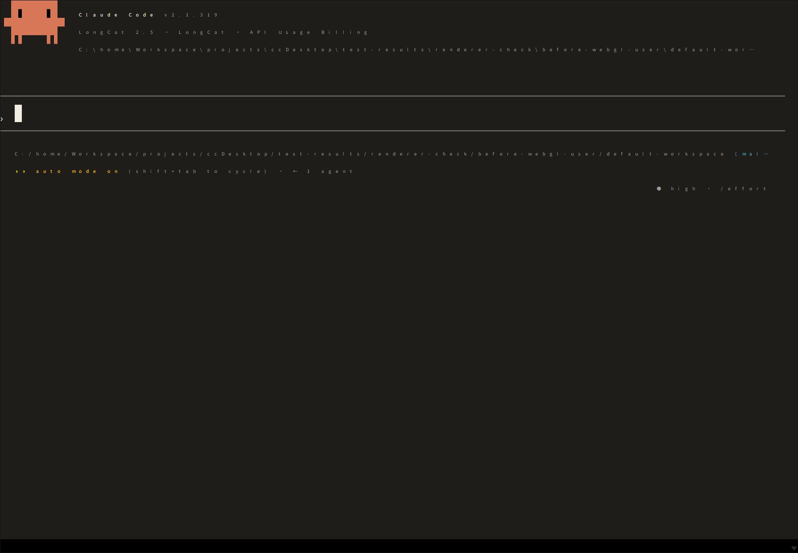
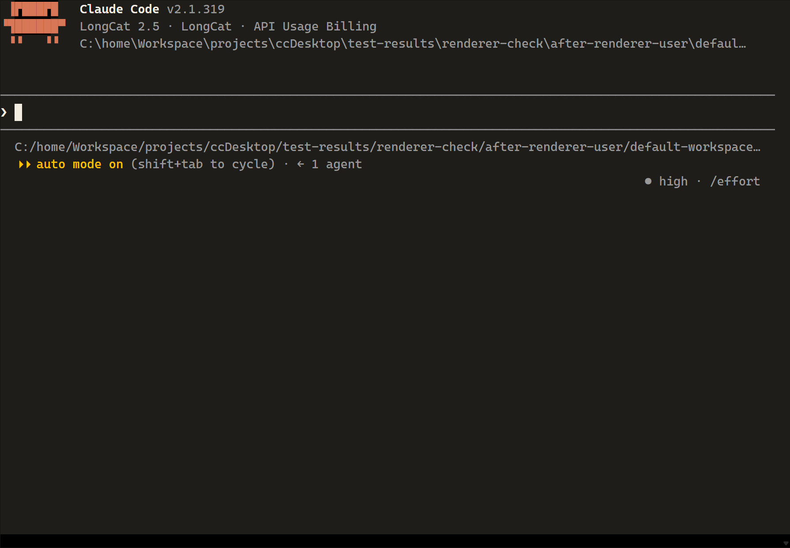
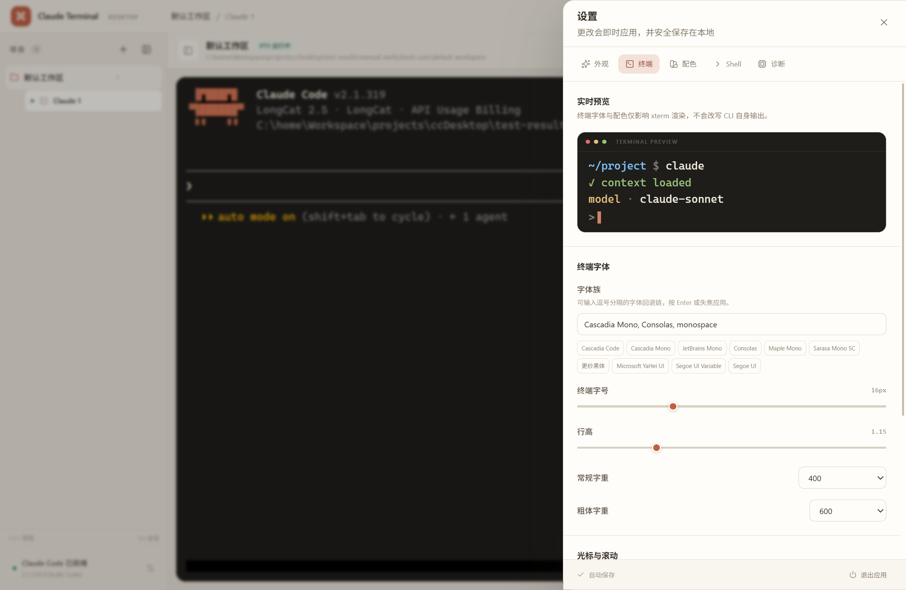
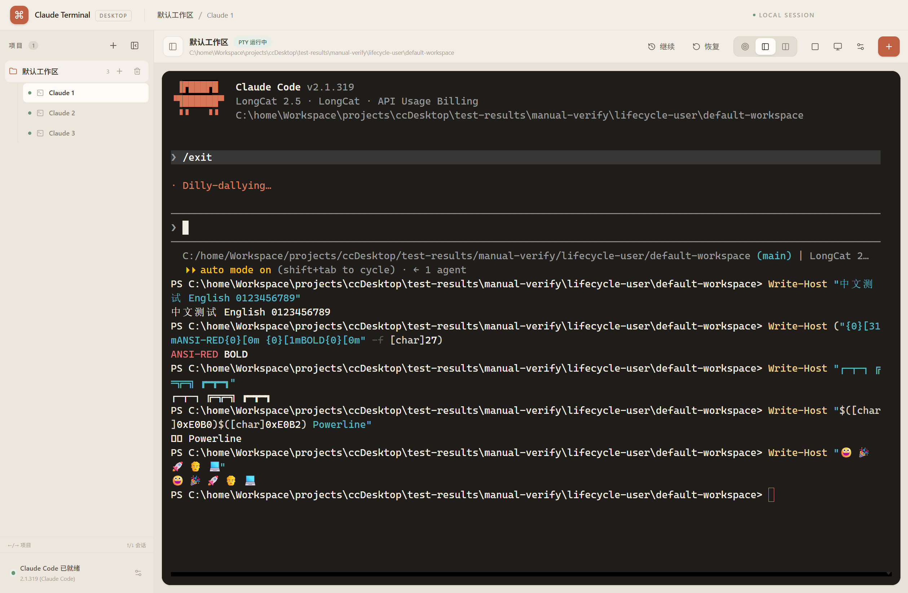

# 终端字体与渲染修复验证

日期：2026-11-12

## 对照结果

同一窗口、同一配置（16px、400 字重、1.15 行高、DPR 1.75）下：

| | 修复前（WebGL renderer） | 修复后（xterm 默认 DOM renderer） |
| --- | --- | --- |
| 截图 |  |  |
| 列数 | 110 | 107 |
| 渲染尺寸 | canvas 内部 `1760x1209`，CSS `1006x691` | `.xterm-screen` `1003x691` |
| 观感 | 字符 advance 被拉大，字形松散、发虚 | 字符等宽、间距正常、清晰 |

结论：字体文件和 PTY 输出正常，异常来自 WebGL 渲染路径。当前按任务要求
暂不加载 `@xterm/addon-webgl`，先使用 xterm 默认 DOM renderer；依赖版本
保持 `@xterm/xterm@6.0.0` / `@xterm/addon-webgl@0.19.0` 不变。

设置页预览与真实终端均为 16px：

字符覆盖（中文、英文、数字、ANSI 红色、Bold、Box Drawing、Emoji）：

## 根因与修复对应关系

| 现象 | 根因 | 修复 |
| --- | --- | --- |
| 隐藏会话首次显示时终端空白、尺寸异常 | 在 `display: none` 容器中执行 `terminal.open()`，容器尺寸为 0 | 仅在 `visible === true` 且 host 尺寸达到 40x30 后初始化；使用 `ResizeObserver` + `requestAnimationFrame` 重试 |
| 首次显示前 PTY 输出丢失 | Terminal 未初始化时没有 writer | 继续使用 `pendingTerminalData`；`terminal.open()` 成功并接好输入监听后再 `registerWriter()`，首次注册消费缓冲 |
| 切换会话后字符错乱、模糊 | 每次显示时清理共享 glyph atlas，且 WebGL 在 DPR 1.75 下 advance 异常 | 删除 `clearTextureAtlas()`；暂时禁用 WebGL；显示时 `fit()` + `refresh(0, rows - 1)` |
| 默认字体偏小、过细 | 旧默认 14px / 1.25 行高 / Cascadia Code | 默认改为 16px / 400 / 600 / 1.15 / padding 14 / `Cascadia Mono, Consolas, monospace` |
| 老用户升级后仍是 14px | `settings.json` 版本仍为 1，旧值覆盖新默认 | 配置版本升到 2；仅当完整匹配旧默认组合时迁移，用户自定义字体/字号/行高保留 |
| 设置预览字号最大只有 15px | 预览使用 `Math.min(terminal.fontSize, 15)` | 移除限制，直接使用真实字号；字体、字重、行高、字距同步 |
| 全局 GUI 字体可能影响终端输入区 | `xterm-helper-textarea` 继承 body 的 GUI 字体 | 初始化及设置更新时同步 textarea 的终端字体、字号、字重、行高和 0 字距 |

## 生命周期验证

- 隐藏且从未显示的会话不会创建 `.xterm`；点击后每个 session 只创建一个实例。
- 三个会话连续切换 30 次，实例标记保持不变，每个 host 始终只有一个 `.xterm`。
- 三个会话在 30 次切换后均为有效尺寸（107x31）；并行模式窗口变化后仍为有效尺寸（40x33）。
- 隐藏会话的 PTY 输出继续写入；重新显示后内容正常。
- 首次显示前 PTY 已产生 `ESC[6n` 并进入 pending；初始化后 xterm 应答，Claude CLI 继续输出完整界面，证明缓冲被消费。

## 自动化命令

| 命令 | 结果 |
| --- | --- |
| `npm run typecheck` | 通过 |
| `npm test` | 5 个测试文件、20 项通过 |
| `npm run check` | 通过（含 ConPTY 检查） |
| `npm run build` | 通过 |
| `npm run test:e2e` | 通过 |

## 尚未解决

- WebGL 的具体 atlas/DPR 源码级根因尚未继续定位；当前以默认 DOM renderer 规避，后续应单独验证 WebGL 兼容性后再决定是否恢复。
- 本机未安装 Cascadia Mono，实际回退到 Consolas；Powerline 私有区字形（U+E0B0/U+E0B2）显示为缺字方框。这是字体覆盖问题，不是终端渲染错位。
- 未覆盖所有 CJK 组合字符、Emoji ZWJ 序列及全部窗口缩放比例。
